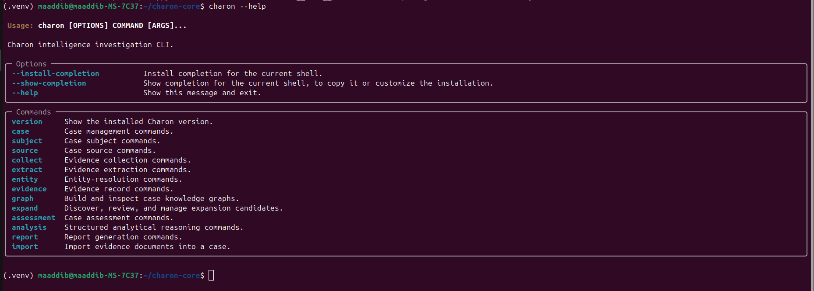
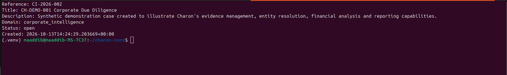
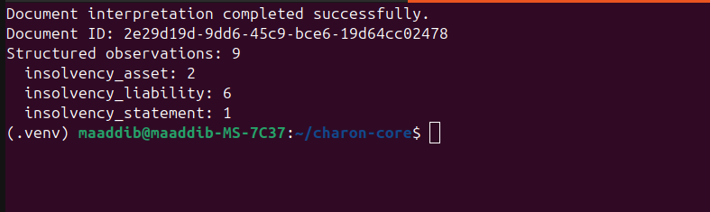
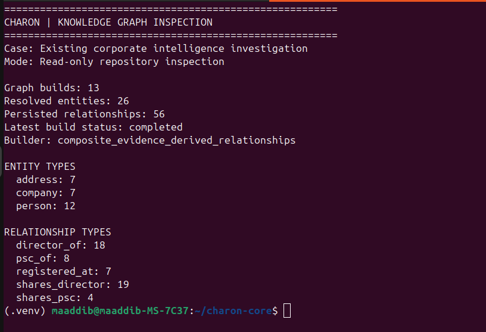

# Charon — Technical Evidence Screenshots

These screenshots document selected implemented capabilities of Charon, an investigative intelligence platform developed to support evidence management, structured extraction, and relationship analysis.

## 1. CLI Overview

**File:** `01-cli-overview.png`

Demonstrates the Charon command-line interface and its available investigative workflows.

## 2. Case Management

**File:** `02-case-management.png`

Demonstrates the creation and retrieval of an investigation case through the command-line interface.

## 3. Financial Information Extraction

**File:** `03-financial-extraction.png`

Demonstrates the processing of an insolvency document and the creation of structured financial observations, including asset, liability, and insolvency-statement classifications.

## 4. Knowledge Graph Inspection

**File:** `04-graph-inspection.png`

Demonstrates the inspection of Charon's persisted knowledge graph, including resolved entities, relationships, and graph-build records.

---

These screenshots provide selected evidence of implemented functionality. They do not constitute an end-to-end validation of every Charon component.

The application's source code and underlying investigative data remain private.
